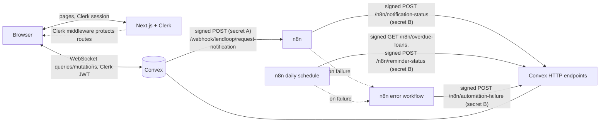
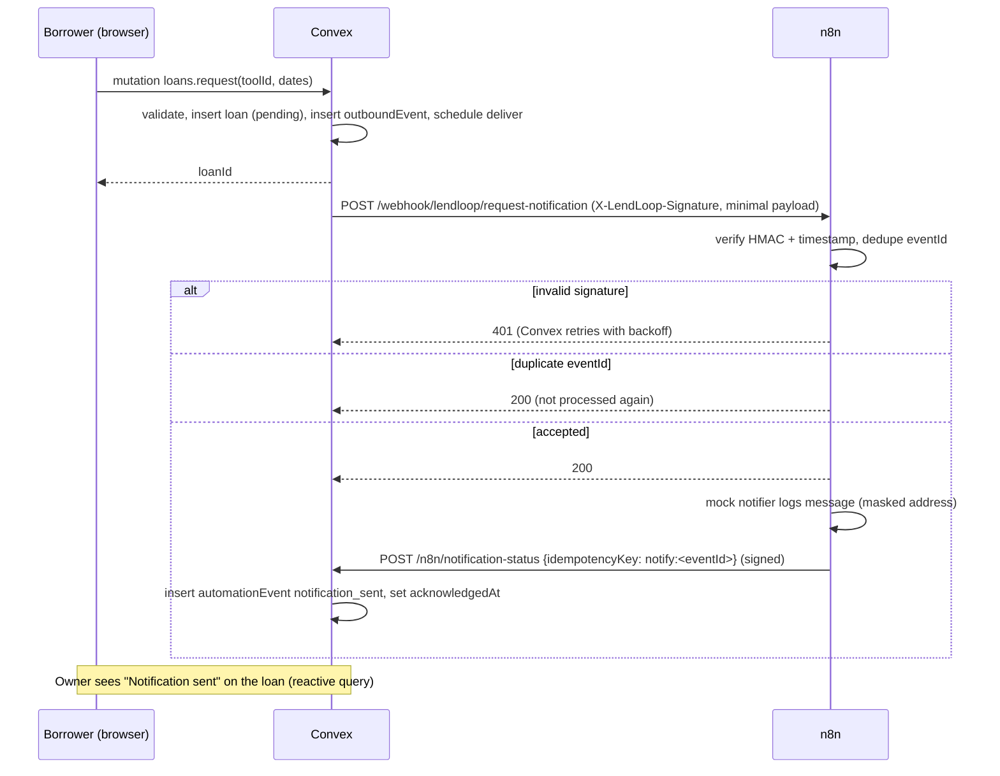

# LendLoop

**Borrow what you need. Lend what you don't.**

LendLoop is a small neighbourhood tool-lending app. Members list tools they own, others request to borrow them for a date range, and owners approve or decline. Every loan event is pushed through a signed webhook to an n8n automation layer (notifications, daily overdue reminders), and the outcome is written back and shown on the loan in the UI.

## Features

- Public board of available tools (name and category only, no sign-in).
- Listings: create, edit, delete your own tools; condition and category (power tools, hand tools, garden, kitchen, camping, cleaning, sports, other).
- Category filter on the signed-in tool list; availability and a "Trusted Lender" badge per owner.
- Borrow requests with a start/end date range (max 30 days, no overlap with approved loans).
- Owner approves or declines; borrower can cancel a pending request; owner or borrower marks an approved loan returned.
- **My listings**, **My requests**, **Incoming requests** pages.
- Admin: remove any listing (affected borrowers are notified), view all loans, grant/revoke Trusted Lender, read the audit log.
- Guardrails: one pending request per borrower per tool (`DUPLICATE_REQUEST`) and at most 5 pending requests per borrower (`RATE_LIMITED`).
- Automation activity on each loan ("Notification sent 2 hours ago", "Reminder sent 1 day ago", "Automation failed ...").

## Tech stack

- Next.js 16 (App Router, TypeScript strict), React 19, Tailwind CSS 4
- Clerk (`@clerk/nextjs`) for authentication; Convex validates the Clerk JWT
- Convex (database, queries/mutations, scheduler, crons, HTTP actions)
- n8n 2.x (self-hosted via Docker Compose) for automation
- Vitest + `convex-test` (edge-runtime) for tests; ESLint 9; pnpm

## Architecture



Secret A is `LENDLOOP_WEBHOOK_SECRET` (Convex to n8n); secret B is `N8N_INBOUND_SECRET` (n8n to Convex). They are different on purpose.

### Data model (`convex/schema.ts`)

| Table | Purpose |
| --- | --- |
| `users` | Mirror of the Clerk identity (`tokenIdentifier`, name, email), `role` (`user`/`admin`), `trustedLender`. |
| `tools` | Listings: owner, name, category, condition, description, denormalized `isAvailable`. |
| `loans` | Borrow requests: tool, owner, borrower, `startDate`/`endDate` (`YYYY-MM-DD`), status `pending/approved/declined/returned/cancelled`. |
| `automationEvents` | What automation did: `notification_sent`, `reminder_sent`, `automation_failed`, with `idempotencyKey` (unique by convention, enforced in code). |
| `outboundEvents` | Outbox for Convex to n8n deliveries: `eventId`, type, status `pending/sent/failed`, attempts, last error, `acknowledgedAt`. |
| `webhookReplay` | Seen nonces/idempotency keys for inbound replay protection; pruned after 24 h by an hourly cron. |
| `auditLogs` | Admin actions: actor, action, target, small metadata. |

### Admin removal

`admin:removeTool` cancels the tool's pending/approved loans and enqueues a `loan.cancelled` event addressed to each borrower (audience override), then deletes the tool and writes a `tool.removed` audit row.

### Outbox and retry flow

Each loan mutation (`request`, `approve`, `decline`, `cancel`, `markReturned`) inserts an `outboundEvents` row (status `pending`, random UUID `eventId`) in the same transaction as the state change and schedules `notifications.deliver`. `deliver` builds the minimal payload, signs it and POSTs to n8n with a 10 s timeout. A 2xx marks the row `sent`; anything else records a short error (e.g. `HTTP 500`, first 200 chars) and reschedules with exponential backoff (5 s, 10 s, 20 s, 40 s; capped at 10 min), up to 5 attempts. After that the row is `failed` and an `automation_failed` event is written for the loan so the failure is visible in the UI. Missing config fails immediately (no retries). The row also snapshots the tool name (`toolName`) at enqueue time, so a notification still names the tool if an admin deletes it before delivery. A sweeper cron runs every 10 minutes and re-schedules `pending` rows older than 15 minutes (lost scheduled jobs). `sent` means n8n accepted the webhook; `acknowledgedAt` is set later when n8n reports back through `/n8n/notification-status`.

### Request-notification flow



### Overdue-reminder flow

```mermaid
sequenceDiagram
  participant T as n8n schedule (09:00 or manual)
  participant C as Convex HTTP
  T->>C: GET /n8n/overdue-loans (signed per attempt, empty body)
  C->>C: verify HMAC, claim nonce get:<signature>
  C-->>T: 200 (excludes loans already reminded today; max 200) {loans:[{loanId,endDate,daysOverdue,tool,borrower}]}
  loop each overdue loan
    T->>T: mock reminder (logged, masked address)
    T->>C: POST /n8n/reminder-status {idempotencyKey: reminder:<loanId>:<UTC date>}
    C->>C: record reminder_sent once per key
    C-->>T: 200 {ok:true,duplicate:false|true}
  end
  Note over T,C: Any node failing 3 tries triggers the error workflow, which POSTs /n8n/automation-failure
```

## Local setup

### Prerequisites

- Node.js 22, pnpm, Docker (with Compose)
- A free [Clerk](https://clerk.com) account
- `openssl` (to generate secrets)

### 1. Install

```bash
pnpm install
cp .env.example .env.local   # then edit as described below
```

### 2. Start Convex (local)

```bash
CONVEX_AGENT_MODE=anonymous npx convex dev
# or, with a Convex account / cloud dev deployment: npx convex dev
```

The anonymous local backend serves the API on `http://127.0.0.1:3210` (write this into `NEXT_PUBLIC_CONVEX_URL`; `convex dev` normally does it for you) and HTTP actions on `http://127.0.0.1:3211`. Leave it running.

### 3. Clerk

1. Create a Clerk application.
2. In the Clerk dashboard enable the **Convex integration** (or create a JWT template named `convex`). The Convex auth config expects `applicationID: "convex"`. Without Clerk configured only the public board and the smoke test work.
3. Copy the publishable and secret keys into `.env.local` as `NEXT_PUBLIC_CLERK_PUBLISHABLE_KEY` and `CLERK_SECRET_KEY`.
4. Copy the Frontend API / issuer URL (e.g. `https://your-app.clerk.accounts.dev`) and set it on Convex (next step) as `CLERK_JWT_ISSUER_DOMAIN`.

### 4. Convex environment variables and shared secrets

```bash
SECRET_A=$(openssl rand -hex 32)   # Convex -> n8n
SECRET_B=$(openssl rand -hex 32)   # n8n -> Convex

npx convex env set CLERK_JWT_ISSUER_DOMAIN https://your-app.clerk.accounts.dev
npx convex env set LENDLOOP_WEBHOOK_SECRET "$SECRET_A"
npx convex env set N8N_INBOUND_SECRET "$SECRET_B"
npx convex env set N8N_WEBHOOK_URL http://localhost:5678/webhook/lendloop/request-notification
# only for the smoke test (never in production):
npx convex env set ALLOW_DEV_SEED true
```

### 5. n8n

Put the same two secrets on the n8n side:

```bash
cp n8n/example.env n8n/.env
# edit n8n/.env: LENDLOOP_WEBHOOK_SECRET=$SECRET_A, N8N_INBOUND_SECRET=$SECRET_B,
# N8N_ENCRYPTION_KEY=$(openssl rand -hex 32), CONVEX_SITE_URL=http://host.docker.internal:3211
cd n8n && docker compose up -d
```

n8n is bound to `127.0.0.1:5678` only (not exposed on the LAN): http://localhost:5678; workflows are imported and published automatically (see [n8n workflows](#n8n-workflows)). Details: [`n8n/README.md`](n8n/README.md).

### 6. Run the app and become admin

```bash
pnpm dev                     # http://localhost:3000
```

Sign up in the app first (this creates your `users` row via `users.store`), then promote yourself from the CLI. Roles can only be changed this way (the change is audited with actor `cli`):

```bash
npx convex run admin:setRole '{"email":"you@example.com","role":"admin"}'
```

Reload; the Admin page becomes available.

### 7. End-to-end smoke test

With Convex dev running, `ALLOW_DEV_SEED=true`, and n8n up:

```bash
node scripts/smoke-n8n.mjs
```

It seeds users/tools/loans through `convex/devSeed.ts` (refuses to run unless `ALLOW_DEV_SEED=true`) and checks: the Convex to n8n to Convex round trip, rejection of unsigned/tampered/expired/wrong-secret requests, eventId dedupe, overdue idempotency across two runs, and the error workflow. It reads secrets from `n8n/.env` and uses `docker compose exec` to run the overdue workflow. The smoke test does not need Clerk.

## Environment variables

| Variable | Lives in | Secret? | Purpose |
| --- | --- | --- | --- |
| `NEXT_PUBLIC_CONVEX_URL` | Next (`.env.local`) | No | Convex deployment URL for the browser client. |
| `NEXT_PUBLIC_CLERK_PUBLISHABLE_KEY` | Next | No (public) | Clerk frontend key. |
| `CLERK_SECRET_KEY` | Next | **Yes** | Clerk server key (middleware). |
| `CLERK_JWT_ISSUER_DOMAIN` | Convex deployment | No | Clerk issuer used to validate JWTs (`convex/auth.config.ts`). |
| `LENDLOOP_WEBHOOK_SECRET` | Convex **and** n8n | **Yes** | Signs Convex to n8n webhooks. |
| `N8N_INBOUND_SECRET` | Convex **and** n8n | **Yes** | Signs n8n to Convex HTTP calls. Different from the one above. |
| `N8N_WEBHOOK_URL` | Convex deployment | No | n8n request-notification webhook URL. |
| `ALLOW_DEV_SEED` | Convex deployment | No | Enables `devSeed:*` functions; dev only. |
| `CONVEX_SITE_URL_LOCAL` | smoke test (shell, optional) | No | Overrides the Convex HTTP actions URL used by `scripts/smoke-n8n.mjs`. |
| `CONVEX_SITE_URL` | n8n (`n8n/.env`) | No | Convex HTTP actions base URL as seen from the container. |
| `N8N_ENCRYPTION_KEY` | n8n | **Yes** | Encrypts credentials stored by n8n. |
| `GENERIC_TIMEZONE` | n8n | No | Timezone for the 09:00 schedule (default UTC). |
| `N8N_DOCKER_SUBNET` | n8n (optional) | No | Pinned Docker subnet, default `172.28.200.0/24`. |

The compose file additionally sets `N8N_BLOCK_ENV_ACCESS_IN_NODE=true` (Code nodes cannot read `$env`), `N8N_CUSTOM_EXTENSIONS=/custom` and `CODE_ENABLE_STDOUT=true`; do not put them in `.env`. The two HMAC secrets are read from the container env only by `n8n/entrypoint.sh`, which writes them into encrypted n8n credentials (type `lendLoopHmacApi`, fixed ids `llCredWebhook01` / `llCredInbound01`) at every start. Signing and verification run in the local `LendLoop HMAC` node (`n8n/custom/n8n-nodes-lendloop`), which reads the secret from the credential; Code nodes never see it.

## Scripts and testing

| Command | What it does |
| --- | --- |
| `pnpm dev` / `pnpm build` / `pnpm start` | Next.js dev server / production build / serve build |
| `pnpm lint` | ESLint |
| `pnpm typecheck` | `next typegen && tsc --noEmit` (generates route types first, so it works on a fresh clone) |
| `pnpm test` | Vitest (single run) |
| `pnpm convex:dev` | `convex dev` |
| `node scripts/smoke-n8n.mjs` | End-to-end n8n smoke test |
| `node scripts/sign-request.mjs LENDLOOP_WEBHOOK_SECRET '<body>'` | Print a signature header for manual `curl` tests |
| `node scripts/build-workflows.mjs` | Regenerate `n8n/workflows/*.json` |

What the test suites cover (`tests/`):

- **Authorization** (`authz`, `convex`): pure decision functions; unauthenticated rejection; non-owner cannot edit/delete/approve; no borrowing own tool; users cannot call admin functions; admin removal writes an audit row; `users.store` never accepts a role; public query exposes only id/name/category.
- **HMAC** (`hmac`): valid, empty body, tampered body/timestamp, wrong secret, expired, future, missing/malformed headers.
- **Idempotency and HTTP** (`http`): 401 for bad signature/wrong secret/expired/future; body shape and size validation; 500 when unconfigured; reminder/notification/failure writes are idempotent; GET replay returns 409; replay-nonce pruning; overdue endpoint excludes already-reminded loans and logs a warning at the 200 cap; failed write-backs upgrade in place.
- **Delivery** (`deliver`): signed minimal payload, retry with backoff then permanent failure, unconfigured webhook.
- **Validation** (`validation`): tool name/description, ISO dates, 30-day limit, overlap, strict inbound bodies.
- **Payload minimization** (`payload`): recipient routing, exact fields, no leaks of descriptions, Clerk ids, full names or the other party's email.
- **Loan lifecycle** (`convex`), **dev seed gating** (`devSeed`), **relative time / activity labels** (`time`), **friendly errors** (`errors`).

## Security and privacy decisions

- **RBAC in Convex, not the UI.** Every public function calls `requireUser` / `requireAdmin` (`convex/lib/authz.ts`); the Clerk proxy and the hidden Admin page are convenience only. Ownership checks (`assertToolOwner`, `assertLoanParty`, `canDecideLoan`, `canCancel`, `canMarkReturned`) are pure functions, unit-tested. An admin does not gain edit rights on others' tools; the admin path is explicit (`admin:removeTool`).
- **Roles only via CLI.** `users.store` upserts name/email from the verified identity and never touches `role`. `admin:setRole` is an `internalMutation`, callable only with `npx convex run`, and writes a `user.role_set` audit row with actor `cli`.
- **HMAC scheme** (`convex/lib/hmac.ts`, Web Crypto). Header `X-LendLoop-Signature: t=<unix seconds>,v1=<hex>`, where `v1 = HMAC-SHA256(secret, "<t>.<raw body>")` (empty body for GET). Timestamps more than 300 s old or in the future are rejected. Comparison is constant-time. The two directions use separate secrets (`LENDLOOP_WEBHOOK_SECRET`, `N8N_INBOUND_SECRET`), so one leak does not allow forging the other direction. Fail closed: a missing secret returns 500 on Convex and the outbound delivery is marked failed; any verification failure returns a generic 401.
- **Replay protection and idempotency.** Valid signatures are still bounded by the 300 s window; on top of that:
  - `X-LendLoop-Event-Id` / `Idempotency-Key` = outbound `eventId` (UUID); n8n de-duplicates on it (last 500 ids in workflow static data).
  - `notify:<eventId>` for notification status.
  - `reminder:<loanId>:<YYYY-MM-DD>` for reminder status (one per loan per UTC day).
  - `fail:<executionId>` for error-handler reports.
  - `get:<signature hex>` nonce for `GET /n8n/overdue-loans` (replay returns 409). n8n signs and sends this GET in the `LendLoop HMAC` node (Signed Request operation), so every retry attempt carries a fresh timestamp and signature.
  - A failed write-back followed by a successful one for the same key is upgraded in place to `sent` (no duplicate row).
  - Duplicate writes return `200 {"ok":true,"duplicate":true}` without a new record. Keys are checked against `automationEvents.by_idempotencyKey`, and also stored in `webhookReplay` (pruned after 24 h).
- **Data minimization.** The only payload sent to n8n is `eventId`, `type`, `occurredAt`, `loan{id,status,startDate,endDate}`, `tool{name}`, `recipient{email,firstName}`, `counterparty{firstName}`. Excluded: tool description, condition, category, full names, the counterparty's email, Clerk ids, role. The recipient is the owner for `loan.requested`/`loan.cancelled`, the borrower otherwise. The overdue endpoint returns only `loanId`, `endDate`, `daysOverdue`, `tool{name}`, `borrower{email,firstName}`. The public board exposes only id, name, category. `tools.list` shows other users only the owner's first name (derived server-side), never the full name. Emails are never returned to other users, and n8n logs mask the address.
- **Secrets handling.** Secrets live in Convex deployment env and in `n8n/.env` (gitignored; only `.env.example` and `n8n/example.env` templates with placeholders are committed). At n8n container start the entrypoint imports them into n8n credentials (encrypted with `N8N_ENCRYPTION_KEY`); workflow JSON references only credential ids/names (no secret values), Code nodes cannot read env (`N8N_BLOCK_ENV_ACCESS_IN_NODE=true`), and it is generated by `scripts/build-workflows.mjs`; never re-export from a live instance without scrubbing. `.gitignore` covers `.env*`, `n8n/.env`, and local Convex/n8n data.
- **Input validation.** Convex `v` validators on all arguments plus `convex/lib/validation.ts`: tool name 2-80 chars, description at most 500, ISO dates, start not in the past, max 30 days, no overlap with approved loans. Inbound n8n bodies are strictly shaped (unknown keys rejected, regex-checked ids/keys/channels, key-to-id consistency) with a 10 KB cap; failure messages reported by n8n are redacted (emails and long token-like strings, `convex/lib/redact.ts`) before storage, then truncated to 300 chars; outbox errors are short fixed strings.
- **Structured logging with redaction.** `convex/lib/log.ts` emits JSON lines and redacts any key matching email/secret/signature/token/authorization/password/`*key` (except `idempotencyKey`). Logs carry ids, not PII.
- **Audit log.** Admin actions are recorded in `auditLogs` (`tool.removed`, `user.trusted_set`/`user.trusted_unset`, `user.role_set` with actor `cli`, `loan.viewed_all`) with actor, target and non-PII metadata; the admin page lists the latest 100. `admin:listAllLoans` is a mutation (not a query) so it writes a `loan.viewed_all` audit row on every load or refresh of the admin page.
- **Failure handling.** Outbox with exponential backoff, a 5-attempt cap and a 10-minute sweeper cron; all n8n HTTP nodes use `retryOnFail` (3 tries, 2 s apart); an n8n error workflow reports failures to `/n8n/automation-failure`, creating an `automation_failed` event shown on the loan (or in the audit-visible events when no loan is known).
- **OWASP notes.** Broken access control (A01): server-side authz everywhere, tested. Injection/validation (A03): typed validators, strict parsing, no dynamic queries. Cryptographic failures (A02): HMAC-SHA256, constant-time compare, secrets out of source. Identification/authentication (A07): Clerk-issued JWTs verified by Convex. Logging/monitoring (A09): structured redacted logs, audit log, visible automation failures. SSRF (A10): webhook URL is operator-configured env, not user input. Insecure design: separate secrets per direction, fail-closed.

## n8n workflows

Source of truth is `n8n/workflows/*.json` (generated by `scripts/build-workflows.mjs`).

| File | Id | What it does |
| --- | --- | --- |
| `request-notification.json` | `llRequestNotify1` | Webhook `POST /webhook/lendloop/request-notification`; verifies signature over the raw body, de-duplicates by `eventId`, responds 401 on failure, mock-notifies (logged), reports to `/n8n/notification-status`. |
| `overdue-reminders.json` | `llOverdueRemind1` | Daily 09:00 schedule plus a manual trigger; signed GET of overdue loans, mock reminder per loan, signed POST to `/n8n/reminder-status`. |
| `error-handler.json` | `llErrorHandler01` | Error Trigger for both workflows (`settings.errorWorkflow`); logs a structured error and POSTs `/n8n/automation-failure`. |

On container start, `n8n/entrypoint.sh` imports all workflows (fixed ids make this idempotent), publishes each one (import deactivates them), then starts n8n. The error handler is published first so `errorWorkflow` references resolve.

To trigger the overdue workflow manually, either open it in the n8n UI (http://localhost:5678) and run the **Manual run** trigger, or from the CLI:

```bash
cd n8n && docker compose exec -T -e N8N_RUNNERS_BROKER_PORT=5680 n8n n8n execute --id llOverdueRemind1
```

## Known limitations

- The notifier is a **logged mock**: no email or SMS is sent. Messages appear in `docker compose logs n8n` (addresses masked).
- The overdue endpoint returns at most 200 loans per call (a warning `overdue.cap_hit` is logged when hit); the rest are picked up on the next run.
- The HMAC secrets live in n8n credentials (Code nodes cannot read env), but they are still passed to the container as env vars so the entrypoint can import them; anyone with `docker inspect` access on the host can read them, and rotating a secret requires recreating the container.
- `loan.*` webhooks are only de-duplicated by n8n's last-500 in-memory static data; a restart with a cleared volume forgets them (Convex still dedupes the write-back).
- Owner `tools.remove` is blocked by approved loans; pending requests are cancelled and each borrower is notified (`loan.cancelled`).
- Lists are capped (`take(100–500)`), no pagination. Overdue detection is UTC-date based.
- Single-instance n8n on SQLite with a local Docker volume; no HA.

## What I'd change for production

- A real transactional email provider with templates, bounce handling and per-user notification preferences.
- Load the n8n credentials from a secret manager instead of container env; secret rotation with key ids in the signature header (accept old and new during rollover).
- n8n in queue mode with Postgres and Redis.
- mTLS or a private network between Convex and n8n; IP allow-listing.
- Field-level encryption for PII (emails) and retention policies for `automationEvents`, `auditLogs`, `outboundEvents`.
- OpenTelemetry tracing/metrics, log shipping, and alerts on `automation_failed` and stuck `pending` outbox rows.
- Rate limiting on mutations and HTTP endpoints; CSP and other security headers.
- Playwright e2e tests with Clerk test users; CI pipeline (lint, typecheck, test, build, smoke test with n8n in a service container).
- A dedicated admin role via Clerk organizations/roles; two-person approval for destructive admin actions.
- Pagination and a dead-letter view/replay button for failed outbox events.
